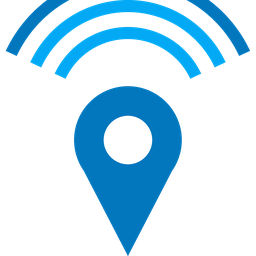
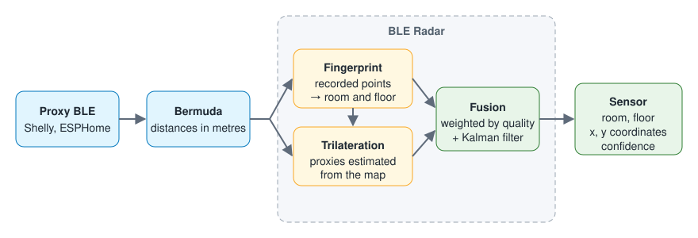
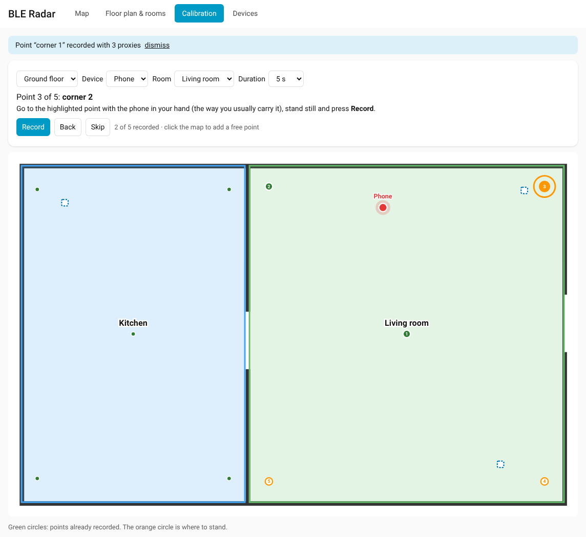
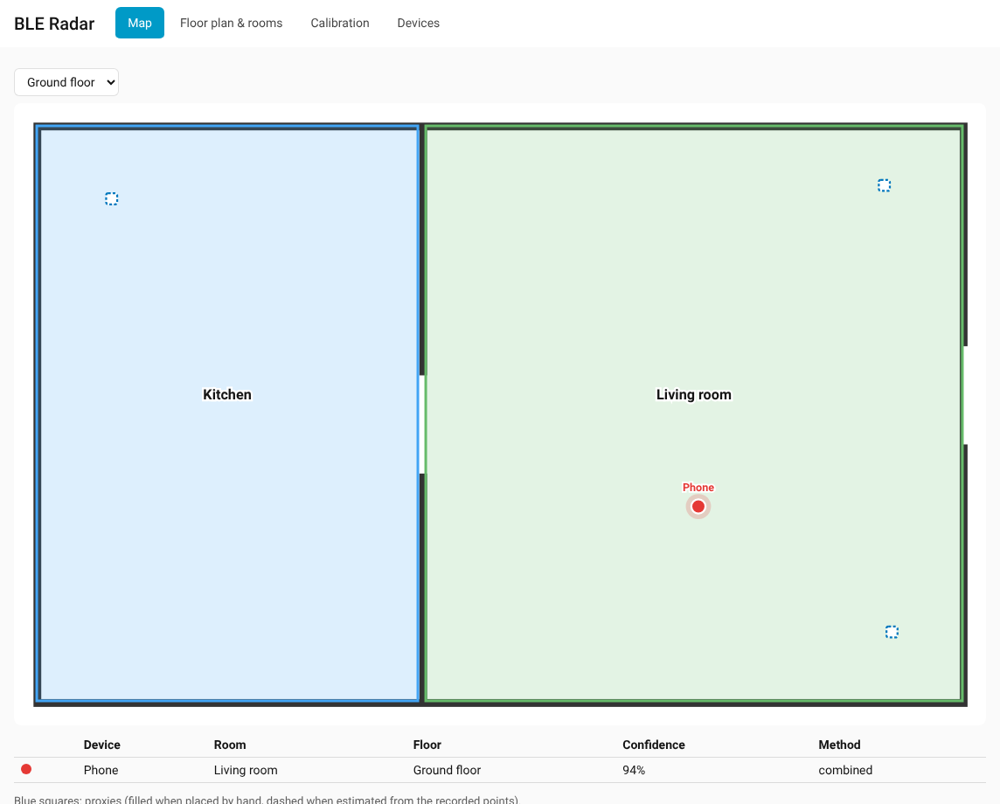
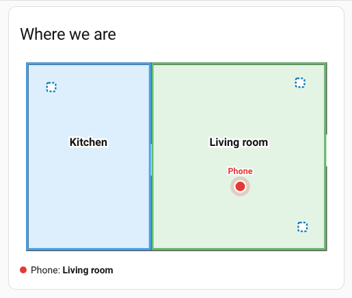

# BLE Radar

🇬🇧 English · 🇮🇹 [Italiano](README.it.md)

[](https://github.com/scoprire87/BLE_Radar/actions/workflows/validate.yml)
[](https://github.com/scoprire87/BLE_Radar/actions/workflows/tests.yml)

Indoor positioning for Home Assistant. BLE Radar estimates the **room**, the **floor**
and the **coordinates (x, y)** of a phone or tag from the BLE distances measured by your
proxies, for example the `sensor.<device>_distance_to_<proxy>` sensors created by
[Bermuda](https://github.com/agittins/bermuda) with ESPHome or Shelly Bluetooth proxies.

It combines two methods:
- **fingerprinting**: the current distances are compared with reference points recorded
  in each room, which copes well with walls and proxies mounted inside wall boxes;
- **trilateration**: the position and the correction factor of every proxy are
  **estimated automatically** from the recorded points, so you never have to measure
  where your proxies are.

Everything is configured from a **sidebar page**: upload a floor plan, draw the rooms,
pick the devices to track and follow a guided calibration. A **dashboard card** shows
the live position. No extra Python libraries are needed (no numpy/scipy).



## Requirements

- Home Assistant 2024.11 or newer.
- Distance sensors for the device to track, typically from
  [Bermuda](https://github.com/agittins/bermuda) (any integration that creates
  `..._distance_to_<proxy>` sensors in metres works).
- At least 3 Bluetooth proxies for trilateration; fingerprinting works with fewer.

## Installation

1. HACS → Integrations → ⋮ → Custom repositories → add this repository (category
   *Integration*).
2. Install **BLE Radar** and restart Home Assistant.
3. Settings → Devices & services → Add integration → *BLE Radar*. It asks nothing: the
   **BLE Radar** page appears in the sidebar.

## The BLE Radar page

Everything is set up from the sidebar page (administrators only).

### 1. Devices

Choose the devices to track: devices with "distance to …" sensors are listed, Bermuda
devices first. Each tracked device gets a position sensor. When Bermuda creates a new
distance sensor for the device (for example after adding a proxy), it is picked up
automatically.

### 2. Floor plan & rooms

1. **New floor**: give it a name (e.g. "Ground floor") and upload the floor plan (PNG,
   JPEG or WEBP; large images are downscaled automatically).
2. **Set scale**: click two points whose distance you know (for example both ends of a
   wall) and enter the metres.
3. **Draw room**: click the corners of the room in order, give it a name and save.
   With **Edit shape** you can drag corners, add a corner by clicking near an edge and
   remove one with a double click.
4. **Move proxies**: proxy positions are estimated from the recorded points (dashed
   squares). If one is wrong, drag it to the right place (it becomes a filled square);
   click it to reset it to the estimate.

### 3. Guided calibration

Choose a device and a room: the page shows the points to record one at a time (the
centre and the corners, half a metre away from the walls). Go to the highlighted point
holding the phone the way you usually carry it, stand still and press **Record**: the
distances are sampled for the chosen duration (15 seconds or more is recommended with
Shelly proxies) and saved with the right coordinates and floor. The page then moves to
the next point. Click on the map to add free points (for example where you usually
sit).



### 4. Map

Shows rooms, proxies and the position of the tracked devices in real time.



## Dashboard card

The **BLE Radar** card shows the floor plan with live positions:



```yaml
type: custom:ble-radar-card
title: Where we are        # optional
floor: Ground floor        # optional: floor name (default: the first floor)
show_proxies: false        # optional
show_rooms: true           # optional
```

## The position sensor

- **State**: the estimated room, or `unknown`.
- **Attributes**:
  - `x`, `y`: estimated coordinates, in floor plan pixels;
  - `floor`, `floor_name`: floor id and name;
  - `fingerprint_room`: the room suggested by fingerprinting alone;
  - `confidence`: confidence of the estimate, from 0 to 1;
  - `method`: `fingerprint`, `trilateration` or `combined`;
  - `score`: difference in metres from the most similar recorded point (lower is
    better);
  - `proxies`: proxies currently in range; `trilateration_proxies` and
    `trilateration_rms`: proxies used by trilateration and its residual in metres.

Each position sensor belongs to its own device, linked to the tracked device.

## How it works

1. **Fingerprinting.** For every recorded point, the RMS difference (in metres) between
   the current and the recorded distances is computed. A proxy seen on one side only
   counts as being at the maximum distance. Among the *k* most similar points, the
   **room** is chosen by a weighted vote and the coordinates are their weighted average.
   The room also gives the **floor**.
2. **Proxies estimated from the map.** From the points with coordinates, the position
   of every proxy and its **correction factor** (measured / real distance) are fitted
   for each floor. The fit uses an asymmetric loss, because walls can only make
   distances longer. The measurements come from your own phone, so the correction is
   calibrated for the tracked device.
3. **Trilateration.** With at least 3 estimated proxies, the position is a weighted
   least-squares fit of the corrected distances (1/r² weights, so nearby proxies count
   more), starting from the fingerprint estimate and bounded to the map. Sudden
   distance jumps are down-weighted instead of discarded.
4. **Fusion.** Both estimates are averaged according to their quality (residual and
   number of proxies).
5. **Smoothing.** A constant-velocity Kalman filter removes jitter; it resets after an
   absence or a floor change.
6. **Drawn rooms.** If the floor has drawn rooms, the room is the one containing the
   computed position; a position outside every room (for example inside a wall) is
   snapped into the nearest room.
7. The room only changes when the new one stays the best match for the confirmation
   time; without any valid proxy for a while, the position becomes unknown.

## Options

From *Configure* on the integration:

| Option | Default | Description |
|---|---|---|
| Show the sidebar page | on | The BLE Radar page |
| Room change confirmation | 5 s | How long the new room must stay the best match (0 = immediate) |
| Back to unknown | 60 s | Time without any valid proxy (0 = never) |
| Smooth movement | on | Kalman filter on the coordinates |

In the **Advanced** section:

| Option | Default | Description |
|---|---|---|
| Trilateration | on | Use the proxies estimated from the map to refine the coordinates |
| Default scale | 1 | Units per metre for points without a floor or floors without a scale (floor scales are set in the sidebar page) |
| Maximum distance | 10 m | Longer distances are ignored |
| Nearest points (k) | 3 | Points used for room and coordinates |
| Minimum common proxies | 2 | Proxies a reading and a point must share |

## Services

Useful for automations or YAML fans; the sidebar page calls them for you.

| Service | What it does |
|---|---|
| `record_vertex` | Record a point from the current distances (median over `duration` seconds) |
| `save_vertex` | Save a point with distances given by hand (`distances: {sensor: metres}`) |
| `delete_vertex` | Delete a point (`room`, `vertex_id`) |
| `delete_room` | Delete a room with all its points |
| `set_proxy` | Set a proxy position (and optionally its correction) by hand; without `x`/`y` the manual setting is removed |
| `get_map` | Return the map, the manually placed proxies and the **estimated** ones (position, correction factor, residual) |

The map is stored in `.storage/ble_fingerprint_map`, floor plans in the
`ble_fingerprint` folder of the Home Assistant configuration.

## Tips

- Record several points per room (corners, centre, places where you usually stay),
  holding the phone the way you usually carry it.
- On Android, in the Home Assistant Companion app, set the *BLE Transmitter* sensor to
  high transmit power and low-latency advertising for steadier distances.
- If the room flickers, increase the room change confirmation time.

## Known limitations

- A proxy that is switched off counts as "far away": until it comes back, rooms near
  it are penalised.
- Accuracy depends on the number and quality of the recorded points.
- Trilateration needs points with coordinates; a proxy outside the area of the
  recorded points (for example in the garden) is estimated less accurately: you can
  place it by hand.

## Upgrading from 1.x

The existing configuration is migrated automatically: the tracked device, its name and
the entity stay the same, and the saved map remains valid (1.0 installations, which did
not store the device, ask you to choose it in the sidebar page). Points recorded
without a floor keep working with fingerprinting only; to use drawn rooms, create the
floor in the sidebar page and record the points with the guided calibration.

## Credits

The trilateration engine, the quality score, the Kalman filter and the per-proxy
correction are inspired by [BPS – BLE Positioning System](https://github.com/Hogster/BPS)
by Hogster (MIT licence, see [THIRD_PARTY_NOTICES.md](THIRD_PARTY_NOTICES.md)). Distance
sensors are usually provided by [Bermuda](https://github.com/agittins/bermuda).

## Development

```bash
pip install -r requirements_test.txt
pytest
```
