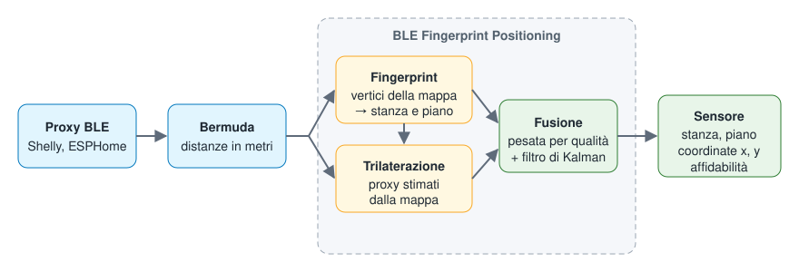

# BLE Fingerprint Positioning

[](https://github.com/scoprire87/BLE_Radar/actions/workflows/validate.yml)
[](https://github.com/scoprire87/BLE_Radar/actions/workflows/tests.yml)

Integrazione custom per Home Assistant che stima la **stanza**, il **piano** e le
**coordinate (x, y)** di un dispositivo a partire dalle distanze BLE misurate dai proxy
(es. i sensori `sensor.<dispositivo>_distance_to_<proxy>` di Bermuda, anche con proxy
Shelly).

Combina due metodi:
- **fingerprint**: confronto con una mappa di punti di riferimento ("vertici")
  registrati in precedenza, robusto a muri e proxy montati in scatole a muro;
- **trilaterazione**: la posizione e la correzione di ogni proxy vengono **stimate da
  sole** dai vertici registrati con coordinate, senza disegnare una planimetria.

Non richiede librerie esterne (niente numpy/scipy).



## Installazione

1. HACS → Integrazioni → Repository personalizzati → aggiungi questo repository.
2. Installa **BLE Fingerprint Positioning** e riavvia Home Assistant.
3. Impostazioni → Dispositivi e servizi → Aggiungi integrazione → *BLE Fingerprint Positioning*.
   Non chiede nulla: compare la pagina **BLE Radar** nella barra laterale.

## La pagina BLE Radar

Tutto si configura dalla pagina nella barra laterale (solo per gli amministratori).

### 1. Dispositivi

Scegli i dispositivi da tracciare: sono elencati quelli con sensori «distance to …»,
per primi quelli di [Bermuda](https://github.com/agittins/bermuda). Per ognuno nasce un
sensore di posizione. Quando Bermuda crea un nuovo sensore di distanza (ad esempio
perché hai aggiunto uno Shelly) l'integrazione lo include da sola.

### 2. Planimetria e stanze

1. **Nuovo piano**: dai un nome (es. «Piano terra», «Taverna») e carica la planimetria
   (PNG, JPEG o WEBP; le immagini grandi vengono ridotte automaticamente).
2. **Imposta scala**: clicca due punti di cui conosci la distanza (ad esempio le due
   estremità di una parete) e scrivi i metri.
3. **Disegna stanza**: clicca sugli angoli della stanza in ordine, dai un nome e salva.
   Con **Modifica forma** trascini gli angoli, aggiungi un angolo cliccando vicino a un
   lato e lo togli con un doppio clic.
4. **Sposta proxy**: la posizione degli Shelly viene stimata dai punti registrati
   (quadrati tratteggiati); se una è sbagliata trascinala nel punto giusto (diventa
   un quadrato pieno). Cliccandola la riporti alla stima.

### 3. Calibrazione guidata

Scegli dispositivo e stanza: la pagina ti indica uno alla volta i punti da registrare
(il centro e gli angoli, a mezzo metro dai muri). Vai nel punto evidenziato con il
telefono in mano, come lo porti di solito, resta fermo e premi **Registra**: le
distanze vengono campionate per la durata scelta (con gli Shelly almeno 15 secondi) e
salvate con le coordinate e il piano giusti. Poi passa da sola al punto successivo.
Cliccando sulla mappa aggiungi punti liberi (ad esempio dove ti siedi di solito).

### 4. Mappa

Mostra in tempo reale stanze, proxy e posizione dei dispositivi tracciati.

## Card per la dashboard

La card **BLE Radar** mostra la planimetria con la posizione in tempo reale:

```yaml
type: custom:ble-radar-card
title: Dove siamo          # opzionale
floor: Piano terra         # opzionale: nome del piano (predefinito il primo)
show_proxies: false        # opzionale
show_rooms: true           # opzionale
```

## Servizi

Utili per automazioni o per chi preferisce lo YAML; la pagina laterale li usa al
posto tuo.

| Servizio | Cosa fa |
|---|---|
| `record_vertex` | Registra un punto leggendo le distanze attuali (mediana su `duration` secondi) |
| `save_vertex` | Salva un punto passando le distanze a mano (`distances: {sensore: metri}`) |
| `delete_vertex` | Elimina un punto (`room`, `vertex_id`) |
| `delete_room` | Elimina una stanza con tutti i suoi punti |
| `set_proxy` | Imposta a mano posizione (ed eventualmente correzione) di un proxy; senza `x`/`y` rimuove l'impostazione |
| `get_map` | Restituisce la mappa, i proxy impostati a mano e quelli **stimati** (posizione, fattore di correzione, residuo) |

La mappa è salvata in `.storage/ble_fingerprint_map`, le planimetrie nella cartella
`ble_fingerprint` della configurazione di Home Assistant.

## Il sensore

- **Stato**: la stanza stimata, oppure `Sconosciuta`.
- **Attributi**:
  - `x`, `y`: coordinate stimate, in pixel della planimetria;
  - `floor`, `floor_name`: id e nome del piano;
  - `fingerprint_room`: la stanza indicata dal solo fingerprint;
  - `confidence`: affidabilità della stima, da 0 a 1;
  - `method`: `fingerprint`, `trilaterazione` o `combinato`;
  - `score`: scarto in metri dal vertice più simile (più è basso, meglio è);
  - `proxies`: proxy validi ora; `trilateration_proxies` e `trilateration_rms`:
    proxy usati dalla trilaterazione e residuo in metri.

Il sensore compare sotto un proprio dispositivo, collegato a quello tracciato.

### Aggiornare dalle versioni 1.x

La configurazione esistente viene migrata da sola: il dispositivo tracciato, il nome e
l'entità restano gli stessi e la mappa salvata resta valida. I punti registrati senza
piano continuano a funzionare con il solo fingerprint; per usare le stanze disegnate
crea il piano nella pagina laterale e registra i punti con la calibrazione guidata.

## Come funziona

1. **Fingerprint.** Per ogni vertice si calcola lo scarto medio (RMS, in metri) tra
   le distanze attuali e quelle salvate. Un proxy visto da una sola parte conta come
   se fosse alla distanza massima. Tra i *k* vertici più simili la **stanza** è scelta
   con un voto pesato e le coordinate sono la loro media pesata. La stanza determina
   anche il **piano**.
2. **Proxy stimati dalla mappa.** Dai vertici con coordinate si ricava, per ogni piano,
   dove si trova ogni proxy e il suo **fattore di correzione** (distanza misurata /
   distanza reale), che assorbe l'attenuazione di quel proxy. Il fit usa una perdita
   asimmetrica: i muri possono solo allungare le distanze. Le misure sono quelle del
   tuo telefono, quindi la correzione è calibrata proprio sul dispositivo tracciato.
3. **Trilaterazione.** Con almeno 3 proxy stimati, la posizione è il fit ai minimi
   quadrati delle distanze corrette (peso 1/r², i proxy vicini contano di più),
   partendo dal punto del fingerprint e limitato all'area della mappa. Le distanze
   cambiate bruscamente vengono attenuate invece che scartate.
4. **Fusione.** Le due stime vengono mediate in base alla loro qualità (residuo e
   numero di proxy).
5. **Movimento fluido.** Un filtro di Kalman a velocità costante riduce i salti; si
   azzera dopo un'assenza o un cambio di piano.
6. **Stanze disegnate.** Se il piano ha stanze disegnate, la stanza è quella che
   contiene la posizione calcolata; se la posizione cade fuori da tutte (ad esempio
   dentro un muro) viene agganciata alla stanza più vicina, come in BPS.
7. La stanza cambia solo se la nuova resta la migliore per il tempo di conferma; se
   per un certo tempo non c'è alcun proxy valido, la posizione torna `Sconosciuta`.

## Opzioni

Da *Configura* sull'integrazione:

| Opzione | Predefinito | Descrizione |
|---|---|---|
| Mostra la pagina nella barra laterale | attivo | La pagina BLE Radar |
| Conferma cambio stanza | 5 s | Tempo per cui la nuova stanza deve restare la migliore (0 = immediato) |
| Ritorno a «Sconosciuta» | 60 s | Tempo senza alcun proxy valido (0 = mai) |
| Movimento fluido | attivo | Filtro di Kalman sulle coordinate |

Nella sezione **Avanzate**:

| Opzione | Predefinito | Descrizione |
|---|---|---|
| Trilaterazione | attiva | Usa i proxy stimati dalla mappa per affinare le coordinate |
| Scala predefinita | 1 | Unità per metro dei punti senza piano o dei piani senza scala (la scala dei piani si imposta nella pagina laterale) |
| Distanza massima | 10 m | Distanze pari o superiori vengono ignorate |
| Vertici più vicini (k) | 3 | Vertici usati per stanza e coordinate |
| Proxy in comune minimi | 2 | Proxy che misura e vertice devono condividere |

## Limiti noti

- Un proxy spento o offline viene trattato come "lontano": finché non torna, le
  stanze vicine a quel proxy risultano penalizzate.
- La precisione dipende dalla quantità e qualità dei vertici registrati.
- La trilaterazione funziona solo con vertici dotati di coordinate; un proxy fuori
  dall'area dei vertici (es. in giardino) viene stimato con meno precisione: in quel
  caso puoi impostarne la posizione con `set_proxy`.
- Le coordinate di ogni piano sono indipendenti: usa lo stesso riferimento per tutti
  i vertici dello stesso piano.

## Riconoscimenti

Il motore di trilaterazione, il punteggio di qualità, il filtro di Kalman e la
correzione per proxy si ispirano a [BPS – BLE Positioning System](https://github.com/Hogster/BPS)
di Hogster (licenza MIT, vedi [THIRD_PARTY_NOTICES.md](THIRD_PARTY_NOTICES.md)).

## Sviluppo

```bash
pip install -r requirements_test.txt
pytest
```
